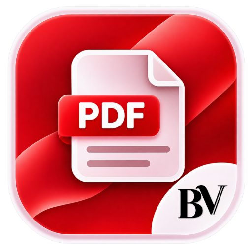

<div align="center">



# BV Reader

**Open any PDF and present it like a pro.**
A fast PDF reader with a built-in dual-monitor slide show, a Presenter View, and smooth fade transitions.

[](../../releases/latest)


</div>

---

## Why BV Reader?

Showing a PDF on a projector should be simple. You should not need a full presentation program, a conversion step, or a pile of settings just to put slides on the big screen.

**BV Reader** opens your PDF and turns it into a slide show with one key press. On two monitors, your audience sees the full-screen slides while you keep a **Presenter View** with the current slide, the next slide, and a timer on your own screen.

It is a great fit for **worship services, church events, seminars, classrooms, meetings, and any occasion** where slides arrive as a PDF and need to be shown on a second display.

## Features

- **Open PDFs your way**: use the **Open PDF** button, drag and drop a file into the window, or double-click a PDF in Windows Explorer.
- **Two reading modes**: **Continuous Scroll** or **Single Page**. In Single Page mode, the mouse wheel flips pages.
- **Flexible zoom**: Fit to Screen, 25%, 50%, 75%, 100%, or any custom size from 10% to 500%.
- **Slide preview panel**: thumbnails on the left. Click one to jump to that page, or hide the panel with a single button. The page number in the toolbar follows your scrolling.
- **One-key slide show**: **F5** starts from the beginning, **Shift + F5** starts from the page you are on. Both are also in the Slide Show menu.
- **Dual-monitor presenting**: full-screen slides on the audience monitor and a **Presenter View** (current slide, next slide, timer, and navigation buttons) on yours.
- **Single-monitor presenting**: the slide show simply fills your only screen.
- **Smooth transitions**: choose **Dissolve**, a clean cross-fade with no dip to black, or a hard **Cut**.
- **Display settings**: choose which monitor shows the Presenter View and which one shows the slide show.
- **Light and Dark themes**: or follow your Windows setting automatically.
- **Modern Windows 11 look**: WinUI 3 style controls, Mica backdrop, and your Windows accent color.
- **Opens PDFs from Explorer**: the installer can register BV Reader as a PDF app, so a double-click or **Open with** just works.
- **One window at a time**: opening another PDF while BV Reader is running loads it in the existing window.

## How it works

BV Reader uses the extended desktop of Windows. A typical presenting setup uses two displays:

```
  +----------------------+        +----------------------+
  |      Monitor 1       |        |      Monitor 2       |
  |    Presenter View    |        |   Full-screen slide  |
  |  (you control here)  |        |  show (the audience  |
  |  current slide       |        |  sees this)          |
  |  next slide, timer   |        |                      |
  +----------------------+        +----------------------+
```

When you start the slide show, the slides fill the **audience** monitor and the Presenter View takes over your **control** monitor. With only one display, the slide show fills that display instead.

## Download and install

Go to the [**Releases**](../../releases/latest) page and download the installer:

| File | Description |
|---|---|
| `BV Reader Setup x.x.x.exe` | **Installer.** Installs for all users into Program Files, with optional PDF association and optional Desktop and Start Menu shortcuts. |

The installer walks you through these steps:

1. **License agreement**
2. **Installation folder** (default: `C:\Program Files\BV Reader`)
3. **PDF association**: choose whether PDF files should be listed with BV Reader
4. **Shortcuts**: choose whether to create Desktop and Start Menu shortcuts
5. **Install**

Windows will ask for administrator permission at the start, because the app is installed for all users.

> **Windows SmartScreen warning?** This app is not code-signed yet, so Windows may show "Windows protected your PC". Click **More info**, then **Run anyway**. The full source code is in this repository for you to inspect or build yourself.

### Make BV Reader your default PDF app

Windows does not let an installer take over the default PDF app by itself. To set it yourself, right-click any PDF, choose **Open with**, then **Choose another app**, pick **BV Reader**, and tick **Always**. You can also do it in **Settings > Apps > Default apps**.

## Quick start

1. **Open BV Reader**, then open a PDF with **Open PDF**, by dragging a file into the window, or by double-clicking a PDF in Explorer.
2. Scroll or use the page box to browse. Click a thumbnail on the left to jump to a page.
3. If you have two monitors, click **Select Monitor** and choose the **Presenter View** monitor and the **Full-Screen Slide Show** monitor. Click **Save**.
4. Pick a **Transition**: Dissolve or Cut.
5. Press **F5** to present from the beginning, or **Shift + F5** to present from the current page.
6. Press **Esc**, or click **End Slide Show**, to finish.

### Controls

| Control | What it does |
|---|---|
| **Menu button** (three lines) | Shows or hides the slide preview panel. |
| **Open PDF** | Opens a PDF file. |
| **Continuous Scroll / Single Page** | Switches the reading mode. |
| **Page box and arrows** | Jump to a page, or go to the previous or next page. |
| **Zoom** | Fit to Screen, preset zoom levels, or a custom size. |
| **Transition** | Dissolve (cross-fade) or Cut (instant). |
| **Select Monitor** | Chooses the Presenter View monitor and the slide show monitor. **Save** keeps your changes, **Cancel** discards them. |
| **Slide Show (F5)** | Starts the slide show from the beginning. The small arrow next to it opens a menu with **From Beginning** and **From This Page**. |
| **End Slide Show** | Leaves the slide show. |
| **Theme** | Light, Dark, or Use system setting. |

### Keyboard shortcuts

| Key | Action |
|---|---|
| `F5` | Start the slide show from the beginning |
| `Shift` + `F5` | Start the slide show from the current page |
| `Esc` | End the slide show, or close an open dialog |
| `→` `↓` `Page Down` `Space` | Next page (during a slide show, or in Single Page mode) |
| `←` `↑` `Page Up` | Previous page (during a slide show, or in Single Page mode) |
| Mouse wheel | Flip pages in Single Page mode |

### Your settings

BV Reader remembers your **theme** and whether the **slide preview panel** is shown. They are saved automatically in your user profile (under `%APPDATA%`).

## System requirements

| | Minimum | Recommended |
|---|---|---|
| **Operating system** | Windows 10, 64-bit | Windows 11 |
| **Displays** | 1 | 2 (Presenter View and audience) |
| **Permissions** | Administrator rights to install into Program Files | |

> The Mica backdrop and the Fluent icons look best on Windows 11. On Windows 10 the app works, but some visual effects are not available.

## FAQ and troubleshooting

**The slide show opens on the wrong monitor.**
Click **Select Monitor**, choose the monitors again, and click **Save**. With only one display, the slide show uses that display.

**A PDF still opens in another program when I double-click it.**
Windows keeps your existing default PDF app. See [Make BV Reader your default PDF app](#make-bv-reader-your-default-pdf-app).

**Windows shows "Windows protected your PC" when I run the installer.**
The installer is not code-signed yet. Click **More info**, then **Run anyway**.

**The background looks plain or dark.**
The Mica effect needs Windows 11 with *Transparency effects* turned on in *Settings > Personalization > Colors*.

**The slide change looks instant.**
Make sure **Transition** is set to **Dissolve**. **Cut** changes slides immediately.

**A PDF will not open.**
Make sure the file is a valid PDF and is not damaged.

## Build from source

You need **Windows 10/11**, [Node.js](https://nodejs.org) (latest LTS), and [Git](https://git-scm.com).

1. Clone this repository and open a terminal in its folder:

   ```
   git clone https://github.com/jordanapit/BV-Reader.git
   cd BV-Reader
   ```

2. Install the dependencies:

   ```
   npm install
   ```

3. Run the app:

   ```
   npm start
   ```

To open a specific PDF right away:

```
npm start -- "C:\path\to\file.pdf"
```

### Build the installer

```
npm run dist
```

The installer is created by [electron-builder](https://www.electron.build) (NSIS target). You will find it in the `dist` folder, for example `dist/BV Reader Setup 1.0.0.exe`.

> The `dist` and `node_modules` folders are not committed to Git (see `.gitignore`). Share installers through the **Releases** page on GitHub.

## Project structure

| File | Purpose |
|---|---|
| `main.js` | Electron main process: windows, displays, theme, file association, single window |
| `index.html` | Main interface: toolbar, slide preview, PDF reader, Presenter View |
| `presenter.html` | Full-screen slide show window for the audience |
| `installer.nsh` | Extra NSIS installer script: option pages, registry entries, shortcuts |
| `package.json` | Project settings and installer build settings |
| `app-icon.ico` / `app-icon.png` | Application icon |
| `LICENSE` / `LICENSE.txt` | License text (GNU GPL v3) |

## Built with

- [Electron](https://www.electronjs.org/)
- [PDF.js](https://mozilla.github.io/pdf.js/) by Mozilla
- [electron-builder](https://www.electron.build/) and [NSIS](https://nsis.sourceforge.io/) for packaging

## Contributing

Bug reports, ideas, and pull requests are very welcome. Please open an [issue](../../issues) to start a conversation.

## License

BV Reader is free and open source software, released under the **GNU General Public License v3.0**. See the [LICENSE](LICENSE) file for details.

Third-party components remain under their own licenses.

## Credits

Developed by **JORD Andreas**.
Published by **BellaVoz Entertainment** ([bellavoz.id](https://www.bellavoz.id/)).

Copyright (c) 2026 BellaVoz Entertainment.
